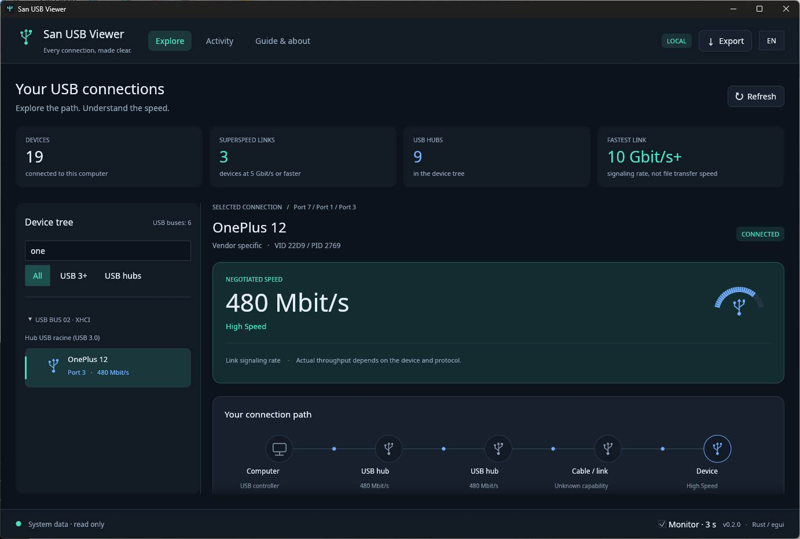

# San USB Viewer

**Basa Sunda** · [English](README.en.md) · [Français](../../README.md) · [50 languages](../README.md)

> Tarjamahan mesin; koréksi wilujeng sumping.

**Vérsi ayeuna: `0.2.0`** — lisénsi MIT.



Asli USB Explorer ditulis dina ** Rust **, kalawan panganteur poék, topologi visual jeung diagnostics bisa dibaca. Vérsi munggaran dimaksudkeun pikeun Windows 10/11.

## Asal proyék

Video dina asal proyék: [https://www.youtube.com/watch?v=xk6GxQEmkus](https://www.youtube.com/watch?v=xk6GxQEmkus).

Proyék ieu diideuan ku kagunaan ** WhatCable ** dina Apple sareng ** USB Device Tree Viewer ** dina Windows: ngartos periferal, hub sareng kecepatan sambungan USB na. Ieu palaksanaan mandiri.

## Fitur

- Deteksi saleresna alat USB sareng pangendali via `nusb`.
- Struktur tangkal ku beus jeung jalur port, kalawan jero hub.
- Pilarian dumasar nami, nomer séri atanapi VID: PID; USB 3+ saringan jeung hub.
- speed link disawalakeun: 1,5 / 12 / 480 Mb/s, 5 Gb/s,
atawa kategori SuperSpeedPlus (10 Gb / s atawa leuwih).
- diagram perjalanan: komputer, hubs panengah, link jeung alat.
- Dina Windows, interogasi tambahan tina hub ku IOCTL pikeun manggihan nu
Kamampuhan SuperSpeed diumumkeun ku alat. Alat anu cocog sareng SuperSpeed disambungkeun via USB 2.0 ngahasilkeun diagnostik watesan jalur.   The USB 2 hubs pendamping tina USB 3 hubs dirawat misah pikeun nyegah atributing maranéhna 480 Mb / s cabangna ka sesar kabel.
- Identifier VID / PID, deskriptor USB, révisi, supir, séri sareng antarmuka,
nalika sistem ngalaan inpormasi ieu.
- Pembaruan otomatis unggal tilu detik, atanapi manual nganggo F5.
- Log sesi panungtungan 200 parobahan observasi.
- Ékspor pernyataan lengkep dina JSON (Ctrl + E) sareng salin detil anu dipilih.
- Pitunjuk terpadu sareng modeu démo eksplisit, henteu pernah dianggo salaku cadangan
jempé bisi gagal deteksi.

## Ngalungkeun

Kalayan Rust **1.95+**, toolchain MSVC sareng alat Visual Studio C++ dina Windows. Conto ngagunakeun RTK pikeun nyaring kaluaran paréntah; tanpa RTK, ngan cabut awalan `rtk`. Skrip distribusi narima duanana kasus.

```powershell
rtk cargo run --release
```

Binér mandiri dihasilkeun dina `target/release/san-usb-viewer.exe`. Aksara `build.ps1` ogé nyiptakeun distribusi dina `dist/SanUsbViewer/`. Henteu aya modifikasi supir atanapi pamasangan WinUSB anu dipikabutuh pikeun inventaris: aplikasi henteu ngabutuhkeun antarmuka alat.

```powershell
# Démonstration avec données fictives, identifiées dans l’interface et l’export
rtk cargo run -- --demo

# Inventaire JSON sur la sortie standard (utiliser le binaire de développement)
rtk cargo run -- --scan

# Capture du rendu réel de l’application, puis fermeture automatique
rtk cargo run -- --screenshot artifacts/live.png
```

Folder tujuan pikeun newak kedah aya. Versi release mangrupakeun aplikasi Windows konsol-kirang; resep `cargo run` dina ngembangkeun pikeun inventory garis paréntah.

## Interprétasi hasilna

The ** speed disawalakeun ** éta sambungan, sarta lain patokan speed salinan. Laju anu kapaké gumantung hususna kana protokol, périferal sareng alat anu sanés ngabagi beus. Laju ti sababaraha alat teu nambahan nepi ka ngitung rubakpita sadia.

Kabel USB pasip umumna sanés alat anu tiasa diémutan. Vérsi ieu teu maca e-spidol na, atawa kakuatan Pangiriman Daya USB, atawa tipe konektor na. Ku kituna teu ngaku ngaku ngajamin speed maksimum na. Diagnosis dumasar kana tautan anu dititénan sareng, upami sayogi, dina indikator Windows. Link slow bisa jadi diwatesan ku kabel, port, hub, atawa alat. Nomer versi deskriptor USB henteu pernah dianggo salaku laju maksimal.

Kategori SuperSpeedPlus teu ngabedakeun antara 10 jeung 20 Gb / s mode dieu. USB4 / Thunderbolt sarta torowongan maranéhna teu inspected. Palabuhan tanpa alat napel teu inventoryed. Kabel ngecas tanpa data henteu nyiptakeun alat anu katingali. Alat internal (Bluetooth, kaméra internal, jsb) tiasa muncul dina tangkal USB.

Inpo nu teu bisa diaksés dipintonkeun salaku teu sadia. Produsén sareng antarmuka henteu salawasna kakeunaan ku Windows. Kajadian anu lumangsung sapinuhna antara panyeken bisa jadi teu katenjo. Log aya dina mémori sareng dimimitian saatos inventory suksés munggaran.

Identifiers beus jeung jalur port ngajelaskeun topologi sistem. Konektor fisik tiasa gaduh dua jalur anu misah pikeun USB 2 sareng SuperSpeed.

## Arsitéktur sarta validasi

`scanner.rs` ngalaksanakeun inventory; `windows_probe.rs` encapsulates requests dibaca asli ti hubs; `model.rs` ngandung data sareng diagnostik. `app.rs` nanganan tugas latar tukang sareng pilihan; `views.rs`, `inspector.rs`, `connection.rs` na `theme.rs` ngagambar panganteur jeung egui / eframe. Antarbeungeut tetep interaktif salami scan sareng nahan bacaan anu suksés terakhir upami scan salajengna gagal.

```powershell
rtk cargo fmt --check
rtk cargo clippy --all-targets -- -D warnings
rtk cargo test --workspace
```

Perpustakaan éta cross-platform sareng kode Windows kondisional. Versi macOS/Linux henteu disahkeun dina pangiriman munggaran ieu.

## Karusiahan

Inventaris tiasa dianggo sacara lokal, ngan ukur dibaca, tanpa telemétri atanapi jasa jaringan. Tautan pituduh ngan dibuka dina klik. Laporan JSON tiasa ngandung nomer séri sareng identifier sistem: ngabagi éta terserah anjeun.

## rujukan teknis

- [nusb: USB enumeration sarta informasi](https://docs.rs/nusb/latest/nusb/struct.DeviceInfo.html)
- [Microsoft: IOCTL_USB_GET_NODE_CONNECTION_INFORMATION_EX_V2](https://learn.microsoft.com/en-us/windows-hardware/drivers/ddi/usbioctl/ni-usbioctl-ioctl_usb_get_node_connection_information_ex_v2)
- [egui / eframe](https://github.com/emilk/egui)

lisénsi MIT. The outbuildings tetep tunduk kana lisensi masing-masing.

Repositori umum ngan ukur ngandung sumber, tarjamahan sareng fon gratis anu dipikabutuh pikeun kompilasi. Maca USB, newak diagnostik, ékspor, preferensi lokal, caches sarta binaries ngembangkeun teu kaasup ku `.gitignore`. Pikeun ngalaporkeun masalah, paké modeu `--demo` atanapi cabut nomer séri sareng ID sistem tina laporan anjeun sateuacan ngabagikeunana.

## Basa - versi 0.2.0

Aplikasina kalebet **50 basa panganteur**. Klik kode basa (`FR`, `EN`, jsb) di katuhu luhur pikeun muka switcher. Anjeun tiasa milarian basa ku nami asli, nami Inggris atanapi kode na. Parobihan éta langsung sareng pilihanna disimpen dina `%APPDATA%/SanUsbViewer/preferences.json` handapeun Windows. Tanpa preferensi, basa sistem dipaké; Basa anu henteu didukung dibalikkeun ka Inggris.

Pilihan milih basa anu paling diucapkeun dina total (basa indung sareng basa kadua), ngahijikeun varian régional. Ieu sanes klasifikasi numerik: hasilna beda-beda gumantung kana pengelompokan dialek. Varian anu dipilih kalebet Cina Sederhana, Arab Standar sareng aksara Latin Fulani sareng Uzbek; Punjabi ngagunakeun Gurmukhi.

Inggris, Cina, Hindi, Spanyol, Perancis, Arab, Bengali, Portugis, Rusia, Urdu, Indonésia, Jerman, Jepang, Marathi, Vietnam, Telugu, Hausa, Turki, Punjabi, Swahili, Filipino, Tamil, Pérsia, Korea, Amharik, Thailand, Jawa, Italia, Gujarati, Kannada, Bhojpuri, Burma, Polandia, Yoruba, Linglaniala, Ukrainian, Ukrainian, Fukudia, Ukrainian, Ukrainian, Fukushima Pashto, Sunda, Malayu, Igbo, Nepali, Azeri, Maithili jeung Somali.

Ménu disalin, diagnostik, téks pitulung, pesen kagiatan sareng detil dilokalkeun. Ngaran sareng identifier anu disayogikeun ku hardware sareng sistem dipikagaduh. Ékspor JSON ngajaga skéma sareng data inventarisna, henteu paduli basa tampilan. Unit teknis tetep dina ** bit / s ** (Mbit / s jeung Gbit / s) pikeun nyegah kabingungan jeung bait.

Katalog Perancis sareng Inggris janten rujukan. Basa anu sanés nyaéta **tarjamahan otomatis**, anu peryogi koréksi linguistik. File `locales/*.json` kalebet dina kompilasi sareng tiasa dilereskeun teras dikompilasi deui. Henteu aya tarjamahan jaringan anu dilakukeun ku aplikasi: 50 basa sareng fon Noto dipasang, dina Lisensi SIL Open Font. Teks Arab nganggo ruas Unicode dua arah sareng garis énggal anu diitung sateuacan pormat.

```powershell
# Forcer une langue pour ce lancement, sans remplacer le choix enregistré
rtk cargo run -- --lang ja

# Vérifier les catalogues, les paramètres et les unités de vitesse
rtk python tools/validate_locales.py

# Capture du guide en arabe
rtk cargo run -- --demo --lang ar --page guide --screenshot artifacts/guide-ar.png
```

`SAN_USB_VIEWER_CONFIG` tiasa ngarujuk kana file préferénsi sanés pikeun nguji atanapi pamasangan portabel. Ngan kode basa disimpen di dinya.
